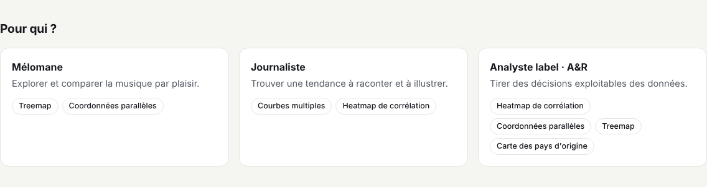

# Utilisateurs et objectifs

[← Sommaire](../README.md)

Nous avons défini trois profils d'utilisateurs. Pour chacun, nous avons listé ses objectifs, les questions concrètes qu'il se pose, puis les tâches de visualisation qui en découlent (5 tâches par profil, 13 tâches distinctes au total). Ce sont ces tâches qui ont guidé le choix des techniques, et non l'inverse.

## Mélomane

**Qui** : une personne qui écoute beaucoup de musique et veut mieux connaître le catalogue, sans connaissances en statistiques. Exemple : une étudiante de 23 ans, 2 à 3 h d'écoute par jour, fan de R&B, sans vocabulaire technique.

**Objectif** : comprendre ses goûts et découvrir des titres hors de ses habitudes.

**Tâches et questions typiques**

| Tâche | Question |
|---|---|
| Localiser (*locate*) | Le R&B est-il une niche ? Quel sous-genre y domine ? Dans quels styles est classé un artiste que j'aime ? |
| Comparer (*compare*) | Qu'est-ce qui différencie mon sous-genre préféré (neo soul) d'un autre (trap) : énergie, acoustique, voix parlée ? |
| Filtrer (*filter*) | Quels titres conviennent pour courir : énergiques, plutôt mélancoliques, 120 à 130 BPM ? |
| Explorer par similarité (*explore*) | À partir d'un titre que j'aime, quels titres au profil audio proche existent dans des genres que je n'écoute pas (latin, EDM) ? |
| Caractériser une tendance (*characterize trend*) | Le R&B des années 1990 était-il plus positif et plus dansant que celui d'aujourd'hui ? |

**Vues utiles** : treemap, coordonnées parallèles, courbes multiples, carte.

## Journaliste

**Qui** : un journaliste culture ou data, ou un créateur de contenu, qui prépare un article sur l'évolution de la musique.

**Objectif** : trouver une tendance ou une relation à raconter, et pouvoir l'illustrer avec des exemples concrets.

**Tâches et questions typiques**

| Tâche | Question |
|---|---|
| Caractériser une tendance (*characterize trend*) | Le rock est-il devenu plus énergique et moins acoustique au fil des décennies ? |
| Comparer dans le temps (*compare over time*) | Le rap et la pop suivent-ils la même trajectoire depuis les années 1980 ? |
| Déterminer une plage (*determine range*) | À quelle période se situe le pic ou le creux d'une caractéristique ? |
| Corréler (*correlate*) | La musique est-elle plus « positive » quand elle est plus dansante ? |
| Extraire (*extract*) | Quel titre ou quel genre marquant mettre en avant pour illustrer l'article ? |

**Vues utiles** : courbes multiples, heatmap de corrélation (et toutes les vues pour extraire un exemple).

## Analyste de label (A&R)

**Qui** : une personne chargée de repérer des artistes et des tendances pour une maison de disques.

**Objectif** : tirer du catalogue des informations exploitables pour décider : où se concentre la production, quels genres restent populaires, quels pays produisent quoi.

**Tâches et questions typiques**

| Tâche | Question |
|---|---|
| Corréler (*correlate*) | Quelles caractéristiques audio sont liées ou redondantes, dans l'ensemble ou dans un genre donné ? |
| Trouver des anomalies (*find anomalies*) | Quels titres sortent du profil de leur genre ? |
| Regrouper (*cluster*) | Quels genres ou titres ont des profils proches ? |
| Calculer une valeur dérivée (*compute derived value*) | Quelle est la popularité moyenne par genre, ou par pays ? |
| Trouver des extrêmes (*find extremes*) | Quels créneaux existent : des sous-genres peu peuplés mais populaires, ou dominés par quelques artistes ? |

**Vues utiles** : heatmap, coordonnées parallèles, treemap, carte.

## Matrice tâches × profils

Les 13 tâches, avec leur importance pour chaque profil et la vue qui les couvre en priorité.
● tâche retenue pour le profil · ○ tâche secondaire · – non pertinente

| Tâche | Mélomane | Journaliste | Analyste | Vue principale |
|---|:-:|:-:|:-:|---|
| Localiser | ● | ○ | ○ | Treemap (recherche), carte |
| Comparer | ● | ○ | ○ | Coordonnées parallèles |
| Filtrer | ● | ○ | ○ | Coordonnées parallèles (+ filtre de genre commun) |
| Explorer (similarité) | ● | – | ○ | Coordonnées parallèles, treemap |
| Caractériser une tendance | ● | ● | ○ | Courbes multiples |
| Comparer dans le temps | – | ● | ○ | Courbes multiples |
| Déterminer une plage | – | ● | ○ | Courbes multiples |
| Corréler | – | ● | ● | Heatmap |
| Extraire | ○ | ● | – | Toutes (infobulles, listes de titres) |
| Trouver des anomalies | – | ○ | ● | Coordonnées parallèles, nuage de points de la heatmap |
| Regrouper | ○ | – | ● | Coordonnées parallèles |
| Calculer une valeur dérivée | – | ○ | ● | Treemap, carte |
| Trouver des extrêmes | – | ○ | ● | Treemap (créneaux), courbes multiples (pic et creux dans le temps) |

## Tâches communes à plusieurs profils

Une même tâche ne sert pas le même objectif selon le profil :

| Tâche | Profils | Usage selon le profil |
|---|---|---|
| Caractériser une tendance | Mélomane, journaliste | Le mélomane vérifie une intuition (le R&B des années 1990 était-il plus positif ?). Le journaliste cherche une évolution qui fera un sujet d'article. |
| Corréler | Journaliste, analyste | Le journaliste illustre un propos (« plus c'est dansant, plus c'est joyeux »). L'analyste repère les variables redondantes pour simplifier son analyse. |
| Localiser | Mélomane (+ les deux autres) | Le mélomane situe son genre préféré. Le journaliste et l'analyste situent un genre ou un marché avant de l'analyser. |
| Comparer | Mélomane (+ les deux autres) | Le mélomane comprend ce qui distingue deux sous-genres. Les deux autres confrontent deux genres. |
| Filtrer | Tous | Étape préalable pour tous : isoler un genre ou une période avant une autre tâche. |

## Ce que nous en retenons

- Chaque profil a un cœur de tâches qui lui est propre : l'**exploration** pour le mélomane, le **temporel** pour le journaliste, l'**analyse et la détection** pour l'analyste.
- **Caractériser une tendance** et **corréler** font le lien entre les profils : c'est pourquoi les courbes multiples et la heatmap servent à deux profils chacune.
- Les **coordonnées parallèles** sont la vue la plus partagée (5 tâches).
- Le **filtre de genre** est l'étape préalable commune à tous : c'est ce qui a motivé un filtre partagé par toutes les vues (voir [Approche](3-approche.md)).

## Des objectifs aux tâches

Nous avons traduit ces questions en tâches abstraites, avec le vocabulaire du cours (Munzner, Shneiderman), puis vérifié que chaque tâche est couverte par au moins une vue.

| Tâche | Exemple de question | Vue principale |
|---|---|---|
| Vue d'ensemble | Comment le catalogue se répartit-il ? | Treemap, carte |
| Comparer | Le profil audio de l'EDM diffère-t-il de celui du rock ? | Coordonnées parallèles |
| Partie / tout | Quelle part du rap fait le southern hip hop ? | Treemap |
| Tendance | Comment l'énergie du rock évolue-t-elle ? | Courbes multiples |
| Comparer dans le temps | Le R&B et le rock suivent-ils la même trajectoire ? | Courbes multiples |
| Corréler | L'énergie va-t-elle avec le volume sonore ? | Heatmap |
| Distribution, anomalies | Quels titres sortent du profil de leur genre ? | Coordonnées parallèles, nuage de points de la heatmap |
| Extrêmes, plage | Quand l'acoustique du rock a-t-elle été la plus basse ? Quels sous-genres sont peu peuplés mais populaires ? | Courbes multiples, treemap |
| Localiser | Où se trouve un artiste dans le catalogue, dans le monde ? | Treemap (recherche), carte |
| Filtrer | Ne regarder qu'un genre, une période, des titres populaires | Toutes les vues (filtre de genre commun) |
| Détails à la demande | Quels sont les titres derrière une moyenne ? | Toutes les vues (infobulles, panneaux, listes de titres) |

Chaque page de visualisation reprend ces tâches et montre, avec un scénario concret, comment la vue les supporte.
