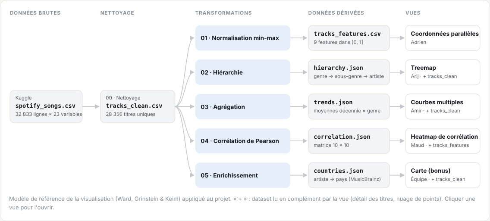

# Le dataset et son traitement

[← Sommaire](README.md)

## 1. Le dataset d'origine

**Source** : « 30000 Spotify Songs », Kaggle (joebeachcapital), fichier [`data/raw/spotify_songs.csv`](../data/raw/spotify_songs.csv).

**Taille** : 32 833 lignes × 23 colonnes. Chaque ligne est un titre **dans une playlist** : 471 playlists, chacune classée dans un genre et un sous-genre.

| Groupe de colonnes | Colonnes | Type |
|---|---|---|
| Titre | `track_id`, `track_name`, `track_artist`, `track_popularity` (0 à 100) | Identifiant, texte, quantitatif |
| Album | `track_album_id`, `track_album_name`, `track_album_release_date` | Identifiant, texte, date (année seule ou date complète) |
| Playlist | `playlist_name`, `playlist_id`, `playlist_genre`, `playlist_subgenre` | Texte, catégoriel (6 genres, 24 sous-genres) |
| Audio, entre 0 et 1 | `danceability`, `energy`, `speechiness`, `acousticness`, `instrumentalness`, `liveness`, `valence` | Quantitatif |
| Audio, autres échelles | `tempo` (BPM), `loudness` (dB), `duration_ms`, `key`, `mode` | Quantitatif, catégoriel |

**Particularités** que le traitement doit gérer :
- un même titre apparaît dans plusieurs playlists, donc plusieurs fois (32 833 lignes pour 28 356 titres uniques) ;
- la date de sortie est tantôt une année, tantôt une date complète ;
- quelques titres n'ont pas de nom ou pas d'artiste ;
- les titres sont très concentrés sur les années 2010 (70 %), et il y en a peu avant 1985 ;
- le genre est celui de la **playlist**, pas un attribut de l'artiste : un artiste peut donc apparaître dans plusieurs genres ;
- il n'y a **aucune information géographique**.

## 2. Le pipeline

Nous avons appliqué le modèle de référence de la visualisation vu en cours : chaque transformation lit un dataset et en produit un nouveau, jusqu'aux données que chaque vue transforme enfin en variables visuelles.



Les transformations 00 à 04 sont dans le notebook [`scripts/pipeline.ipynb`](../scripts/pipeline.ipynb). L'enrichissement 05 est dans le script [`scripts/enrich_countries.py`](../scripts/enrich_countries.py), parce qu'il interroge un service en ligne pendant environ 3 heures. Tous les fichiers produits sont dans [`data/derived/`](../data/derived/) et sont versionnés, pour que l'application tourne directement après un `git clone`.

```
spotify_songs.csv (brut)
   │ 00 nettoyage
   ▼
tracks_clean.csv (D0)
   ├─ 01 normalisation ──► tracks_features.csv (D1) ──► coordonnées parallèles, heatmap (nuage)
   ├─ 02 hiérarchie ─────► hierarchy.json (D2) ───────► treemap
   ├─ 03 agrégation ─────► trends.json (D3) ──────────► courbes multiples
   ├─ 04 corrélation ────► correlation.json (D4) ─────► heatmap
   └─ 05 enrichissement ─► countries.json (D5) ───────► carte
```

### 00 · Nettoyage : `spotify_songs.csv` → `tracks_clean.csv` (D0)

| | |
|---|---|
| Entrée | Le fichier brut, 32 833 lignes |
| Opérations | Suppression des doublons sur `track_id` (on garde la première playlist du titre) ; nom manquant remplacé par « Unknown Track » ; année extraite de la date de sortie ; colonnes renommées (`genre`, `subgenre`, `artist`, `popularity`) |
| Variables calculées | `year`, `decade` (année arrondie à la décennie), `duration_min` (durée en minutes), `mood` (valence × énergie) |
| Sortie | 28 356 titres uniques, 19 colonnes. Ce fichier sert aussi de « détail des titres » pour plusieurs vues. |

### 01 · Normalisation : D0 → `tracks_features.csv` (D1)

| | |
|---|---|
| Entrée | `tracks_clean.csv` |
| Opération | Normalisation min-max de `tempo` et `loudness` dans [0, 1] (colonnes `tempo_n`, `loudness_n`), les autres caractéristiques audio y étant déjà |
| Pourquoi | Les coordonnées parallèles et le nuage de points comparent des caractéristiques entre elles : il faut des échelles comparables |
| Sortie | 28 356 titres avec identifiant, nom, artiste, genre, sous-genre, popularité et 9 caractéristiques dans [0, 1] |

### 02 · Hiérarchie : D0 → `hierarchy.json` (D2)

| | |
|---|---|
| Entrée | `tracks_clean.csv` |
| Fonction | `build_hierarchy(data)` |
| Opération | Regroupement genre → sous-genre → artiste. Pour chaque artiste, on garde **par décennie** le nombre de titres et la somme de leurs popularités. Artiste manquant remplacé par « (artiste inconnu) » |
| Pourquoi par décennie | La treemap peut filtrer par décennie et calculer une popularité moyenne exacte sans relire les 28 356 titres |
| Sortie | Arbre au format `d3.hierarchy` : 6 genres, 24 sous-genres, 14 700 feuilles artiste / sous-genre |

### 03 · Agrégation temporelle : D0 → `trends.json` (D3)

| | |
|---|---|
| Entrée | `tracks_clean.csv` (titres sans année exclus) |
| Opération | Pour chaque couple décennie × genre : nombre de titres et moyenne de chaque caractéristique audio et de la popularité |
| Sortie | Une ligne par décennie × genre, avec le nombre de titres pour juger de la fiabilité de chaque moyenne |

### 04 · Corrélation : D0 → `correlation.json` (D4)

| | |
|---|---|
| Entrée | `tracks_clean.csv` |
| Opération | Matrice de corrélation de Pearson entre les 7 caractéristiques dans [0, 1], le tempo, le volume sonore et la popularité |
| Sortie | Matrice 10 × 10 avec les noms des caractéristiques. La heatmap recalcule elle-même la matrice quand on filtre un genre. |

### 05 · Enrichissement : D0 + MusicBrainz → `countries.json` (D5)

| | |
|---|---|
| Entrée | Les 10 692 artistes de `tracks_clean.csv` et la base ouverte MusicBrainz |
| Fonctions | `load_artists()`, `lookup(name, areas)`, `same_artist(candidate, name)`, `area_country(area_id, areas)`, `write_output(...)` |
| Opération | Recherche de chaque artiste par son nom ; on ne garde qu'un résultat dont le nom ou un alias correspond exactement ; si MusicBrainz ne donne qu'une ville, on remonte jusqu'au pays ; conversion en code ISO alpha-3, celui du fond de carte |
| Variable calculée | Le pays d'origine de l'artiste (pays du groupe pour un groupe). Ce n'est pas le pays d'écoute. |
| Sortie | Lien artiste → pays pour tous les artistes, avec le nom et la région de chaque pays. 7 973 artistes ont un pays, soit 85 % des titres. |

Le détail de cet enrichissement est dans la [page de la carte](vues/carte.md#2-enrichissement-des-données).

## 3. La dernière transformation, dans chaque vue

Chaque vue charge ses fichiers par un point d'accès unique, [`js/DataLoader.js`](../js/DataLoader.js), qui met en cache chaque fichier pour qu'il ne soit lu qu'une fois. La vue réalise ensuite le *mapping* vers ses variables visuelles :

| Vue | Données lues | Dernière transformation |
|---|---|---|
| Coordonnées parallèles | D1 | Moyenne par genre ou titres individuels, une échelle par axe |
| Treemap | D2, D0 | Filtre par décennies ou par popularité, calcul des rectangles (`d3.treemap`) |
| Courbes multiples | D3, D0 | Une série par genre, limitée à la période choisie ; titres d'un point lus dans D0 |
| Heatmap | D4, D1 | Matrice recalculée par genre, échantillon de points pour le nuage |
| Carte | D5, D0, fond de carte | Regroupement des titres par pays (et par genre si filtré), cercles proportionnels, bulles d'artistes |

## 4. Limites des données

- Le genre vient de la playlist dans laquelle le titre a été trouvé : c'est une classification éditoriale, pas une propriété objective.
- Le dataset n'est pas un échantillon représentatif de Spotify : les genres sont volontairement équilibrés (de 4 137 à 5 401 titres), et les années 2010 dominent.
- La popularité est un instantané au moment de la collecte : un titre récent a mécaniquement plus de chances d'être populaire.
- Le pays d'origine dépend de la qualité de MusicBrainz (voir la [page de la carte](vues/carte.md#8-limites)).
