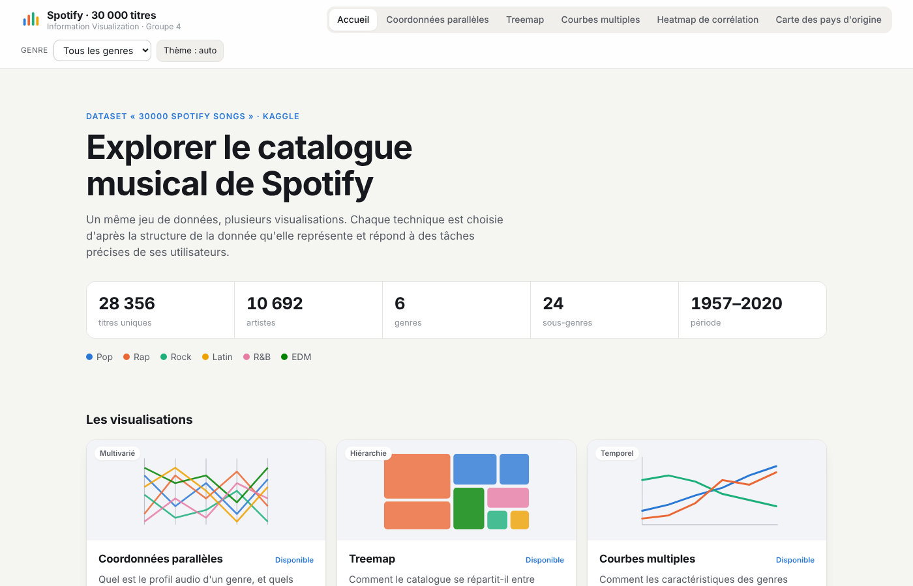

# Approche de visualisation et coordination des vues

[← Sommaire](README.md)

## 1. Une technique par structure de données

Plutôt que de montrer les mêmes données de plusieurs façons, chaque vue répond à une question différente, et la technique a été choisie d'après la **structure de la donnée** concernée :

| Structure | Question | Technique | Auteur |
|---|---|---|---|
| Multivariée (9 caractéristiques par titre) | Quel est le profil audio d'un genre, et quels titres se ressemblent ? | Coordonnées parallèles | Adrien |
| Hiérarchique (genre → sous-genre → artiste) | Comment le catalogue se répartit-il ? | Treemap zoomable | Arij |
| Temporelle (décennies) | Comment les caractéristiques évoluent-elles ? | Courbes multiples | Amir |
| Matricielle (paires de caractéristiques) | Quelles caractéristiques vont ensemble ? | Heatmap de corrélation | Maud |
| Spatiale (pays d'origine, après enrichissement) | D'où viennent les artistes ? | Carte à symboles proportionnels | Maud et Arij |

Toutes les vues suivent le mantra de Shneiderman : une **vue d'ensemble** à l'ouverture, puis du **zoom et des filtres**, puis des **détails à la demande** (infobulles, listes de titres, nuage de points, fiches d'artistes).

## 2. Organisation : une page d'accueil à onglets

Parmi les manières de coordonner plusieurs vues vues en cours (vues juxtaposées, écran partagé, onglets…), nous avons choisi des **onglets**, réunis dans [`index.html`](../index.html) :

- **Pourquoi des onglets** : chaque technique a besoin de place (une treemap ou des coordonnées parallèles écrasées dans un quart d'écran deviennent illisibles), et les vues répondent à des questions différentes qu'on ne se pose pas toutes en même temps.
- **Page d'accueil** : elle présente le dataset en chiffres, les couleurs des genres, une carte par visualisation (question posée, type de données, tâches supportées, auteur), les profils d'utilisateurs avec un lien vers les vues qui les concernent, et le schéma du pipeline. On peut ouvrir une vue depuis l'onglet, la carte ou le schéma.
- **Chaque vue reste une page autonome** (`treemap.html`, `heatmap.html`…), affichée dans un cadre. Cela évite les conflits de CSS et de JavaScript entre les vues, permet à chacun de développer et tester sa vue séparément, et chaque vue garde son état quand on change d'onglet.
- La liste des vues est déclarée à un seul endroit (`VISUS`, en haut de [`js/index.js`](../js/index.js)). Une vue pas encore fusionnée apparaît « à venir ».

## 3. Un état commun : le filtre de genre et le thème

Avec des onglets, l'utilisateur ne voit qu'une vue à la fois : il faut donc que ce qu'il fait dans une vue se retrouve dans les autres. Les vues partagent un état commun, géré par [`js/filters.js`](../js/filters.js) :

- **Filtre par genre** : choisi dans la barre de la page d'accueil ou dans une vue, il s'applique à toutes les vues et reste actif quand on change d'onglet. Chaque vue l'interprète selon sa technique :

| Vue | Effet du genre choisi |
|---|---|
| Coordonnées parallèles | Ne garde que ce genre (et ses sous-genres) |
| Treemap | Zoome sur ce genre |
| Courbes multiples | N'affiche que la courbe de ce genre |
| Heatmap | Recalcule la matrice de corrélation sur les titres de ce genre |
| Carte | Ne compte que les titres de ce genre |

- **Thème** : automatique (celui du système), clair ou sombre, appliqué à toutes les vues.

Techniquement, l'état est mémorisé dans `localStorage` et les cadres sont prévenus des changements par l'événement `storage` du navigateur. Chaque vue s'abonne avec `Filters.onChange(...)` et publie avec `Filters.set({ genre })`.

Le **genre** est le seul filtre commun, parce que c'est le seul qui a un sens pour toutes les techniques. Les autres contrôles (décennies, popularité, caractéristique affichée, sous-genres…) restent propres à chaque vue : isoler une décennie, par exemple, viderait les courbes.

## 4. Un même langage visuel

- **Couleurs des genres** identiques partout, définies une seule fois dans [`js/DataLoader.js`](../js/DataLoader.js) (`GENRE_COLORS`) : le rap est toujours orange, la pop toujours bleue… L'utilisateur n'a pas à réapprendre la légende d'une vue à l'autre.
- **Mêmes noms** de genres et de caractéristiques.
- **Thème clair et sombre** dans toutes les vues.
- **Accessibilité** : textes alternatifs, contraste vérifié, navigation au clavier dans l'index (flèches entre les onglets) et dans les vues qui le permettent.

## 5. Les visualisations

- [Coordonnées parallèles](vues/coordonnees.md) · Adrien Verstraelen
- [Treemap zoomable](vues/treemap.md) · Arij Lemjid
- [Courbes multiples](vues/courbes.md) · Amir Benayhia
- [Heatmap de corrélation](vues/heatmap.md) · Maud Marconcini
- [Carte des pays d'origine (bonus)](vues/carte.md) · Maud Marconcini et Arij Lemjid
