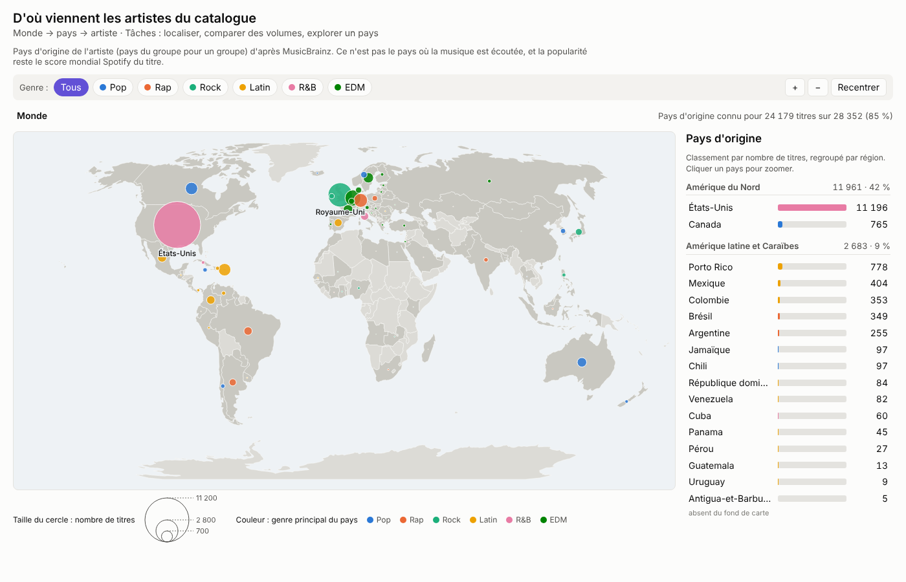
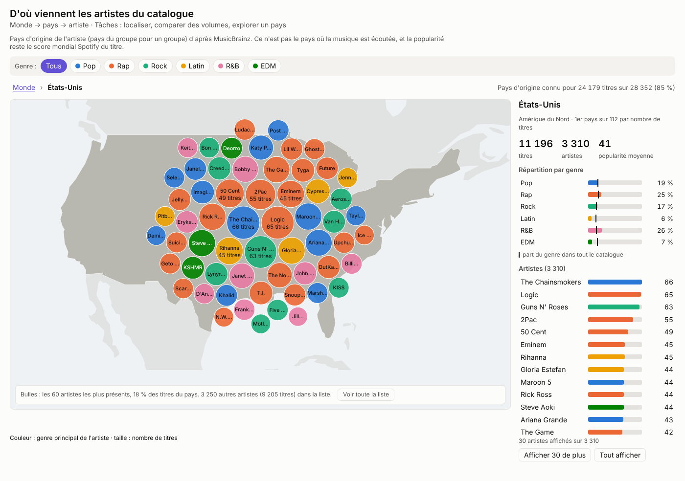
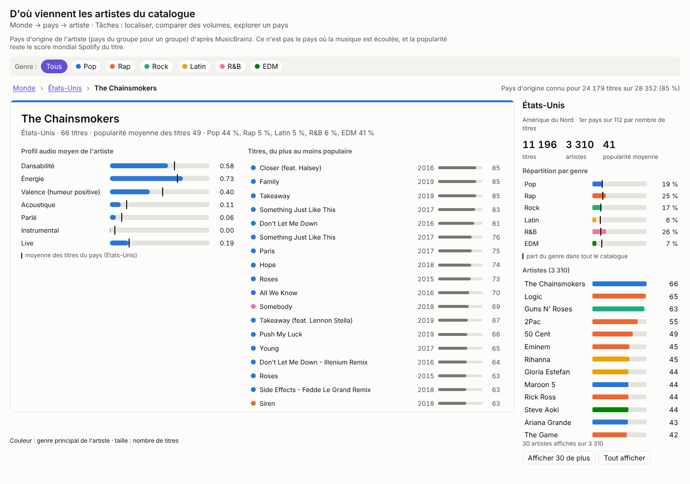
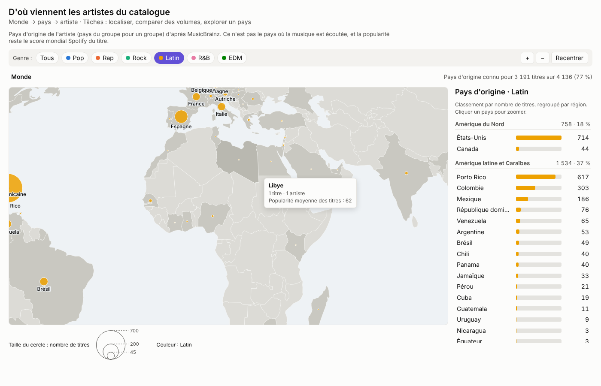

# Carte des pays d'origine (bonus) : monde → pays → artiste

[← Sommaire](../../README.md)

**Auteures : Maud Marconcini et Arij Lemjid**
Maud a fait la première version (choroplèthe et premier script d'enrichissement sur 800 artistes). Arij a étendu l'enrichissement à tous les artistes et refait la vue avec des symboles proportionnels et un zoom sémantique.

Fichiers : [`carte.html`](../../carte.html) · [`js/views/carte.js`](../../js/views/carte.js) · [`css/carte.css`](../../css/carte.css) · [`scripts/enrich_countries.py`](../../scripts/enrich_countries.py)
Données : [`data/derived/countries.json`](../../data/derived/countries.json) (D5), [`data/derived/tracks_clean.csv`](../../data/derived/tracks_clean.csv) (D0), [`data/world.geojson`](../../data/world.geojson) (fond de carte)

## 1. Question et données représentées

La vue répond à la question : **d'où viennent les artistes du catalogue, et quelle musique vient de chaque pays ?**

Le dataset Kaggle ne contient **aucune information géographique**. Il a donc fallu l'enrichir avec une variable calculée : le **pays d'origine de l'artiste**.

**Définition retenue** : le pays de l'artiste, ou du groupe pour un groupe, tel que renseigné dans la base ouverte MusicBrainz. Ce n'est **pas** le pays où la musique est écoutée, et la popularité reste le score mondial Spotify du titre. Cette définition est rappelée en haut de la vue, parce qu'une carte invite naturellement à lire « là où on écoute ».

## 2. Enrichissement des données

Le script [`scripts/enrich_countries.py`](../../scripts/enrich_countries.py) interroge MusicBrainz pour **les 10 692 artistes** (une requête par seconde, environ 3 h, reprise possible grâce à un cache).

| Étape | Fonction | Entrée → sortie |
|---|---|---|
| Liste des artistes | `load_artists()` | `tracks_clean.csv` → artistes triés du plus au moins fréquent |
| Recherche | `lookup(name, areas)` | Nom → code pays ISO alpha-2, ou vide si non trouvé |
| Vérification du nom | `same_artist(candidate, name)` | Garde un résultat seulement si son nom ou un alias correspond exactement (accents et casse ignorés), pour éviter les homonymes |
| Ville → pays | `area_country(area_id, areas)` | Quand MusicBrainz ne donne qu'une ville, on remonte les zones parentes jusqu'au pays (Londres → Angleterre → Royaume-Uni) |
| Écriture | `write_output(...)` | Lien artiste → pays en ISO alpha-3 (codes du fond de carte), noms et régions des pays → `countries.json` |

**Résultat** : 7 973 artistes sur 10 692 ont un pays (112 pays), ce qui couvre **85 % des titres**. La première version n'interrogeait que les 800 artistes les plus fréquents (37,6 % des titres) et ne gardait qu'un total par pays. Garder le lien artiste → pays était nécessaire pour descendre jusqu'aux artistes et pour appliquer le filtre de genre.

Les titres dont l'artiste n'a pas de pays **ne sont pas retirés** : ils sont comptés dans un bloc « Sans pays » du panneau, avec le nombre d'artistes concernés.

## 3. Pourquoi des symboles proportionnels plutôt qu'une choroplèthe

La première version colorait la surface de chaque pays selon son nombre de titres (choroplèthe). Ce choix pose deux problèmes :

- Une choroplèthe convient à un **taux** ou une densité, pas à un **compte**. Avec un compte, la surface du pays pèse dans la perception : le Canada (765 titres) paraît énorme, alors que Porto Rico (778 titres, plus que le Canada) est presque invisible.
- Les États-Unis (11 196 titres) écrasent l'échelle de couleur, et la plupart des autres pays se ressemblent.

La carte affiche donc **un cercle par pays dont l'aire est proportionnelle au nombre de titres**, placé au centre de son territoire principal (la France métropolitaine plutôt que la moyenne avec la Guyane, par exemple). La couleur du cercle indique le **genre principal** du pays, avec les couleurs communes du projet. Le fond de carte reste neutre et ne sert qu'à se repérer.

Comme une aire se compare moins précisément qu'une longueur, le panneau de droite donne aussi le **classement exact** en barres, regroupé par région (Amérique du Nord, Amérique latine et Caraïbes, Europe…). Ce regroupement répond aussi au fait qu'une carte du monde entière est trop large : on peut raisonner par région avant de descendre au pays.

## 4. Utilisateurs et tâches

- **Analyste label (A&R)** : savoir d'où vient la production d'un genre, repérer des pays spécialisés.
- **Mélomane** : découvrir les artistes d'un pays et leur style.

| Tâche | Comment la vue la supporte |
|---|---|
| Localiser | Position géographique des cercles, noms des pays qui apparaissent avec le zoom |
| Comparer des volumes | Aire des cercles, classement en barres par région |
| Caractériser | Couleur du genre principal, répartition par genre d'un pays comparée au catalogue |
| Explorer | Zoom libre (molette, boutons), clic sur un pays, puis sur un artiste |
| Filtrer | Genre, commun à toutes les vues du projet |
| Détails à la demande | Infobulle, panneau du pays, fiche artiste |

## 5. Mode d'emploi

### 5.1 Niveau monde

Chaque cercle est un pays. L'infobulle donne le nombre de titres, d'artistes, la popularité moyenne et le genre principal avec sa part. On peut zoomer avec la molette ou les boutons + et −, et « Recentrer » revient à la vue complète.

Le zoom est déjà **sémantique** à ce niveau : les cercles gardent la même taille à l'écran, et plus on zoome, plus il y a d'étiquettes. À partir d'un certain niveau, chaque étiquette affiche aussi le nombre de titres.

### 5.2 Niveau pays (zoom sémantique)

Un clic sur un pays, sur la carte ou dans le classement, zoome sur son territoire. La représentation change alors de nature : le cercle du pays **éclate en bulles d'artistes** (taille = nombre de titres, couleur = genre principal de l'artiste). C'est le principe évoqué en cours : en s'approchant d'un lieu, on affiche des détails qu'il est impossible de montrer sur la carte entière.

Le panneau du pays affiche ses chiffres, son rang, et sa **répartition par genre** avec un repère noir pour la part du genre dans tout le catalogue. La liste complète des artistes est disponible (30 par 30, ou tout afficher). Les bulles montrent les 60 artistes les plus présents, et une ligne sous la carte dit quelle part des titres ils représentent et combien d'autres artistes sont dans la liste.

*Scénario (analyste A&R) :* « Le Royaume-Uni produit-il la même musique que les États-Unis ? » Non : 42 % des titres britanniques sont du rock (contre 15 % dans le catalogue), alors qu'aux États-Unis le R&B (26 %) et le rap (25 %) dominent. Les Pays-Bas sont encore plus spécialisés : 66 % de leurs titres sont de l'EDM (Martin Garrix, Hardwell, Tiësto…).

### 5.3 Niveau artiste

Un clic sur une bulle ou un nom ouvre la fiche de l'artiste, construite comme celle de la treemap : profil audio moyen avec un repère pour la moyenne du pays, et liste des titres du plus au moins populaire, avec un point de couleur pour le genre de chaque titre.

Le fil d'Ariane (Monde › pays › artiste) et la touche Échap permettent de remonter d'un niveau.

### 5.4 Filtrer par genre

Le filtre de genre ne garde que les titres de ce genre : les cercles, le classement et les bulles sont recalculés. Il est partagé avec les autres vues ([`js/filters.js`](../../js/filters.js)).

*Scénario (analyste A&R) :* « D'où vient la musique latine ? » En Amérique latine, Porto Rico arrive en tête (617 titres, 79 % de sa production est latine), devant la Colombie et le Mexique. Mais les États-Unis ont plus de titres latins (714) que n'importe lequel de ces pays, et l'Espagne et l'Italie apparaissent en Europe.

## 6. Choix de conception

- **Honnêteté sur les données** : la couverture est affichée en permanence (« Pays d'origine connu pour 24 179 titres sur 28 352 (85 %) »), et les titres sans pays restent comptés.
- **Accessibilité** : cercles et bulles sont des boutons utilisables au clavier, avec un libellé ARIA (« États-Unis : 11 196 titres, 3 310 artistes, popularité moyenne 41. Entrée pour explorer. »), le focus revient sur le pays quand on remonte, la couleur du texte des bulles est choisie selon le contraste WCAG, et les animations sont coupées avec `prefers-reduced-motion`.
- **Noms des pays en français**, à partir des codes ISO (`Intl.DisplayNames`).
- **Thème** clair ou sombre, commun à toutes les vues.

## 7. Fonctions principales de la vue

| Fonction (`js/views/carte.js`) | Entrée | Sortie |
|---|---|---|
| `parseTrack(row)` | Une ligne de `tracks_clean.csv` | Un titre validé, ou `null` |
| `aggregate(tracks, enrichment, genre)` | Titres, lien artiste → pays, genre filtré | Un groupe par pays (titres, artistes, popularité moyenne, genres), plus les groupes « origine inconnue » et « pas encore interrogés » |
| `mainPolygon(feature)` | Un pays du GeoJSON | Son plus grand polygone, pour placer le cercle et calculer le zoom |
| `drawSymbols()` | Groupes par pays | Cercles proportionnels (`d3.scaleSqrt`) |
| `drawBubbles(country, origin)` | Artistes d'un pays | Bulles placées par `d3.pack`, animées depuis la position du pays |

## 8. Limites

- MusicBrainz n'est pas toujours juste : Rihanna y est rattachée aux États-Unis alors qu'elle vient de la Barbade. Certains artistes connus n'y sont pas trouvés sous leur nom Spotify (Kanye West y est enregistré sous « Ye »).
- 4 titres sans nom d'artiste ne peuvent pas être rattachés à un pays.
- Le pays d'origine dit où la musique est produite, pas où elle est écoutée. Une vraie popularité par pays demanderait d'autres données (classements Spotify par pays).
