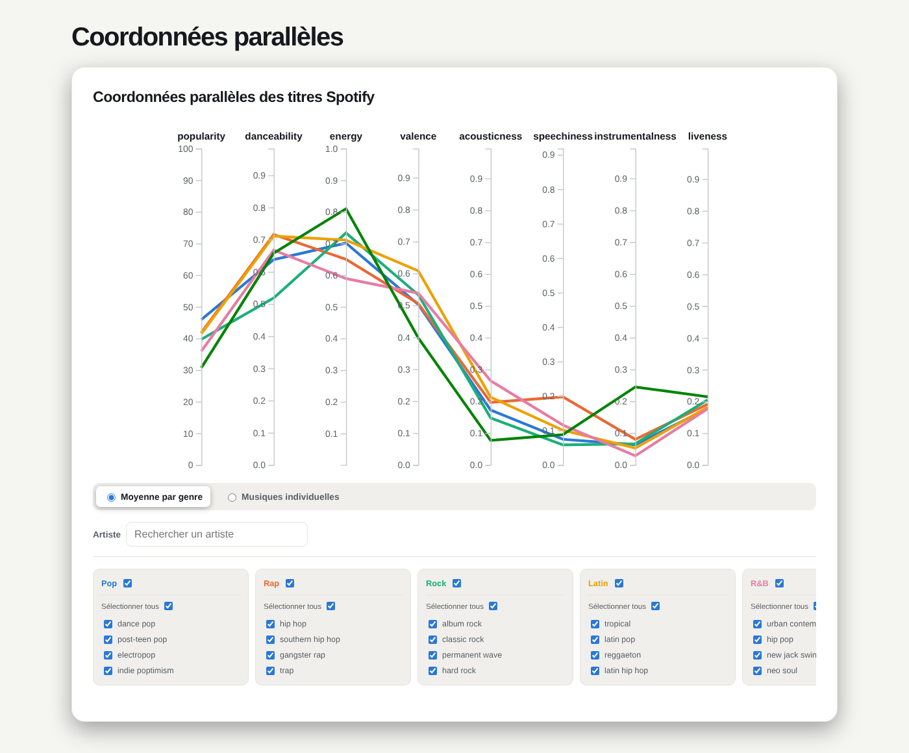
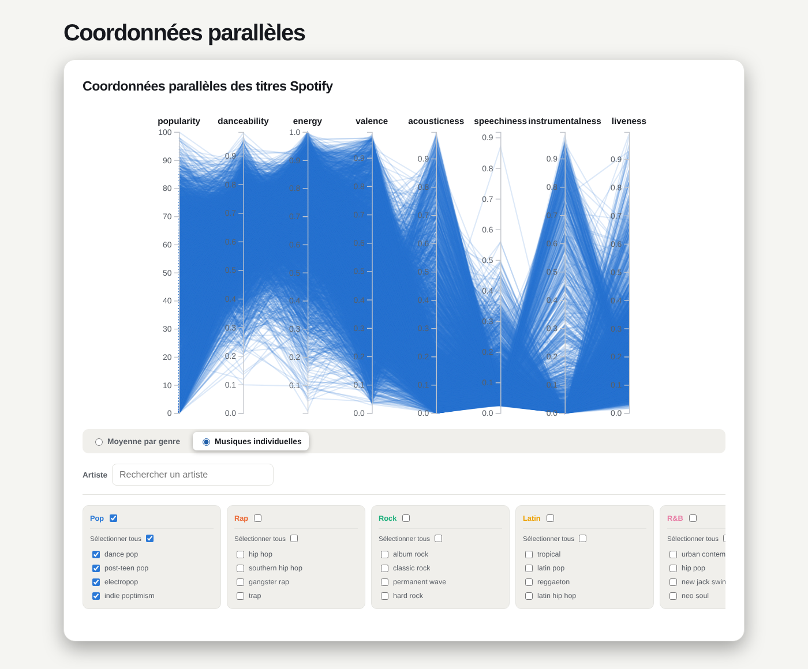

# Coordonnées parallèles : le profil audio des genres et des titres

[← Sommaire](../../README.md)

**Auteur : Adrien Verstraelen**

Fichiers : [`coord-para.html`](../../coord-para.html) · [`js/main.js`](../../js/main.js) · [`js/views/parallels_coords.js`](../../js/views/parallels_coords.js)
Données : [`data/derived/tracks_features.csv`](../../data/derived/tracks_features.csv) (D1)

## 1. Question et données représentées

La vue répond à la question : **quel est le profil audio d'un genre, et quels titres se ressemblent ?**

Chaque titre est décrit par plusieurs variables quantitatives à la fois : la popularité et 7 caractéristiques audio (dansabilité, énergie, valence, acoustique, parole, instrumental, live). C'est une donnée **multivariée** : on veut voir toutes les variables ensemble, pas deux par deux.

## 2. Pourquoi des coordonnées parallèles

- Les coordonnées parallèles affichent autant de variables que d'axes verticaux : chaque titre (ou chaque moyenne de genre) devient une ligne qui traverse tous les axes. On lit son profil complet d'un coup d'œil.
- Comparer des genres revient à comparer la forme de leurs lignes.
- Des lignes qui se croisent entre deux axes voisins signalent une relation inverse, des lignes parallèles une relation directe.
- Un nuage de points ne montrerait que deux variables à la fois, et un graphique radar se lit mal dès qu'il y a plusieurs séries.

Chaque axe a sa propre échelle (`d3.scaleLinear` sur l'étendue de la variable). La popularité est de 0 à 100, les caractéristiques audio sont dans [0, 1].

## 3. Utilisateurs et tâches

- **Mélomane** : trouver des titres qui ressemblent à ceux qu'il aime.
- **Analyste label** : comparer le profil des genres, repérer des titres atypiques.

| Tâche | Comment la vue la supporte |
|---|---|
| Comparer | Une ligne épaisse par genre en mode « Moyenne par genre » |
| Distribution | Mode « Musiques individuelles » : la densité des lignes sur un axe montre la répartition des valeurs |
| Filtrer | Brossage sur chaque axe, cases à cocher par genre et sous-genre, recherche d'artiste, filtre de genre commun |
| Anomalies | Les lignes qui sortent du faisceau de leur genre |
| Détails à la demande | Infobulle au survol d'une ligne (titre, artiste, genre, sous-genre, popularité) |

## 4. Mode d'emploi

### 4.1 Comparer les genres (moyenne par genre)

À l'ouverture, la vue affiche **une ligne par genre**, qui passe par la moyenne de chaque variable. Le survol d'une ligne la met en avant et affiche ses valeurs.

*Scénario (analyste label) :* « En quoi l'EDM se distingue-t-elle des autres genres ? » Sa ligne (verte) est la plus haute sur l'énergie (0,81) et sur l'instrumental (0,24), la plus basse sur l'acoustique (0,08) et sur la popularité (31 en moyenne). Le rap se distingue par la part de parole (0,20) et la dansabilité (0,72), le latin par la valence la plus haute (0,61), et la pop est le genre le plus populaire en moyenne (46).

### 4.2 Explorer les titres (musiques individuelles)

Le mode « Musiques individuelles » dessine **un trait par titre**, en transparence pour que les zones denses ressortent. Pour garder la vue lisible, ce mode ne montre qu'un genre à la fois, et on peut ne cocher que certains sous-genres.

### 4.3 Brosser les axes

On peut **tracer un intervalle sur chaque axe** (brossage) : seules les lignes qui passent dans tous les intervalles restent affichées. Les filtres se combinent.

*Scénario (mélomane) :* « Je cherche de la pop très dansante mais calme. » En mode individuel sur la pop, brosser la dansabilité vers le haut (au-dessus de 0,8) et l'énergie vers le bas (en dessous de 0,5) ne laisse qu'une centaine de titres sur 5 132, par exemple « Don't Touch My Hair » de Solange ou « Alaska » de Maggie Rogers. Le survol donne le nom, l'artiste, le sous-genre et la popularité de chaque titre.

### 4.4 Rechercher un artiste

Le champ « Artiste » ne garde que les titres (ou les moyennes) des artistes dont le nom contient le texte saisi. On compare ainsi le profil d'un artiste à celui de son genre.

### 4.5 Coordination avec les autres vues

La vue utilise le filtre de genre commun du projet : un genre choisi ailleurs ne laisse que ce genre ici, et ne garder qu'un genre ici le transmet aux autres vues.

## 5. Choix de conception

- **Couleurs** : les couleurs de genre communes au projet (`DataLoader.genreColor`).
- **Deux niveaux de lecture** : la moyenne par genre pour la vue d'ensemble, les titres individuels pour le détail, ce qui limite le sur-tracé (28 356 lignes superposées seraient illisibles).
- **Transparence** des lignes individuelles pour faire apparaître la densité.

## 6. Fonctions principales

| Fonction (`ParallelCoordinates`) | Entrée | Sortie |
|---|---|---|
| `constructor(containerSelector, data, characteristics)` | Conteneur, lignes de D1, liste des axes | Vue initialisée (échelles, contrôles) |
| `calcutateAverageByGenre()` | Titres des sous-genres cochés et de l'artiste recherché | Une moyenne par genre pour chaque variable |
| `isWithinBrushes(track)` | Un titre | Vrai s'il passe dans tous les intervalles brossés |
| `matchesArtist(track)` | Un titre | Vrai si son artiste correspond à la recherche |
| `path(d)` | Un titre ou une moyenne | Le tracé de sa ligne à travers les axes |
| `render()` | État courant (mode, filtres, brossages) | Lignes et axes redessinés |
| `setupSharedFilter()`, `broadcastGenre()` | Genre commun | Synchronisation avec les autres vues |

## 7. Limites et pistes

- L'ordre des axes est fixe : certaines relations (énergie et acoustique, par exemple) se verraient mieux avec des axes voisins. Permettre de réordonner les axes par glisser-déposer serait utile.
- Le mode individuel est limité à un genre à la fois.
- La page charge D3 en version 5, alors que les autres vues utilisent la version 7.
