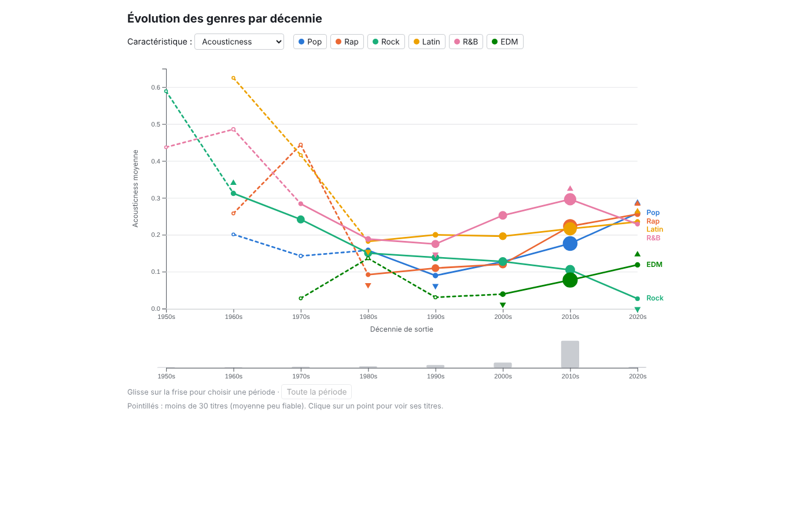

# Courbes multiples : l'évolution des genres par décennie

[← Sommaire](../../README.md)

**Auteur : Amir Benayhia**

Fichiers : [`courbes.html`](../../courbes.html) · [`js/courbes/courbes.js`](../../js/courbes/courbes.js)
Données : [`data/derived/trends.json`](../../data/derived/trends.json) (D3) et [`data/derived/tracks_clean.csv`](../../data/derived/tracks_clean.csv) (D0) pour le détail des titres

## 1. Question et données représentées

La vue répond à la question : **comment les caractéristiques des genres évoluent-elles dans le temps ?**

Les données sont **temporelles** : pour chaque genre et chaque décennie (des années 1950 aux années 2020), la moyenne d'une caractéristique et le nombre de titres sur lesquels elle repose.

## 2. Pourquoi des courbes multiples

- Une courbe par genre sur un axe du temps commun permet de lire la **tendance** de chaque genre et de **comparer** les genres entre eux à chaque époque.
- La position sur un axe commun est le canal le plus précis pour comparer des valeurs (Munzner).
- Une seule caractéristique est affichée à la fois, choisie dans une liste : mettre les 10 dans le même graphique le rendrait illisible, et des petits multiples prendraient beaucoup de place pour 6 genres.

## 3. Utilisateurs et tâches

- **Journaliste** : trouver une évolution à raconter (« le rock est devenu plus électrique »).
- **Analyste label** : voir quels genres changent et dans quel sens.

| Tâche | Comment la vue la supporte |
|---|---|
| Tendance | Une courbe par genre, décennie par décennie |
| Comparer dans le temps | Axe Y commun à tous les genres, qui ne change pas quand on en masque un |
| Extrêmes | Au survol d'une courbe, triangles ▲ max et ▼ min avec leur valeur (décennies fiables seulement) |
| Filtrer | Choix de la caractéristique, légende cliquable, frise de sélection de la période, filtre de genre commun |
| Détails à la demande | Infobulle sur chaque point, clic pour lister les titres les plus populaires de ce genre et de cette décennie |

## 4. Mode d'emploi

### 4.1 Choisir une caractéristique

La liste « Caractéristique » propose les 7 caractéristiques audio, le tempo, le volume sonore et la popularité. L'axe Y s'adapte à la caractéristique choisie.

### 4.2 Lire la fiabilité d'une moyenne

Le dataset contient très peu de titres anciens (3 titres dans les années 1950, contre 19 834 dans les années 2010). Pour ne pas tromper l'utilisateur :
- la **taille de chaque point** est proportionnelle au nombre de titres ;
- un point **vide** et une ligne en **pointillés** signalent une moyenne calculée sur moins de 30 titres, donc peu fiable ;
- la **frise** sous le graphique montre le nombre de titres par décennie.

### 4.3 Comparer et repérer les extrêmes

Survoler une courbe la met en avant, estompe les autres, et affiche son maximum et son minimum.

*Scénario (journaliste) :* « Le rock est-il devenu moins acoustique ? » Avec la caractéristique « Acousticness », la courbe du rock descend régulièrement : 0,31 dans les années 1960, 0,15 dans les années 1980, 0,10 dans les années 2010. En passant à « Energy », elle monte de 0,61 à 0,78 sur la même période. Les pointillés des années 1950 rappellent qu'on ne peut rien conclure avant 1960 (2 titres de rock seulement).

### 4.4 Choisir une période

Glisser sur la frise sélectionne une période (arrondie aux décennies, deux au minimum) : le graphique zoome sur cette période. « Toute la période » revient à l'ensemble.

### 4.5 Voir les titres derrière un point

Cliquer sur un point affiche, sous le graphique, les 5 titres les plus populaires de ce genre et de cette décennie, et leur nombre total.

*Scénario (mélomane) :* cliquer sur le point du rock des années 1970 donne les titres les plus populaires de cette décennie, et montre sur quels titres repose la moyenne affichée.

### 4.6 Masquer des genres et coordination

Cliquer sur un genre dans la légende le masque ou le réaffiche. Le filtre de genre commun du projet n'affiche que la courbe du genre choisi.

## 5. Choix de conception

- **Couleurs** de genre communes au projet, et nom du genre écrit au bout de chaque courbe (les étiquettes trop proches sont écartées) pour ne pas obliger à aller et venir vers la légende.
- **Échelle Y fixe** quand on masque des genres, pour que les comparaisons restent valables.
- **Honnêteté sur les données** : taille des points, pointillés et frise rendent visible la faible quantité de titres anciens.

## 6. Fonctions principales

| Fonction (`js/courbes/courbes.js`) | Entrée | Sortie |
|---|---|---|
| `buildSeries()` | `trends.json`, genres masqués, période | Une série de points par genre visible |
| `drawChart()` | Séries, caractéristique choisie | Axes, lignes (pointillées si moins de 30 titres), points proportionnels au nombre de titres |
| `drawExtremes(gGenre, x, y)` | Séries dessinées | Marqueurs du maximum et du minimum de chaque courbe |
| `setupContext()`, `brushed(event)`, `setPeriod(p)` | Nombre de titres par décennie, sélection sur la frise | Période arrondie aux décennies |
| `drawDetails()` | Point sélectionné, `tracks_clean.csv` | Les 5 titres les plus populaires du genre et de la décennie |
| `setupSharedFilter()` | Genre commun | Genres masqués synchronisés avec les autres vues |

## 7. Limites et pistes

- Les années 2010 représentent 70 % des titres : les tendances sur les décennies anciennes reposent sur peu de titres, même au-dessus du seuil de 30.
- La décennie est une granularité grossière, choisie à cause de ce manque de titres anciens.
- La popularité est mesurée au moment de la collecte : sa courbe dans le temps reflète surtout ce qu'on écoute aujourd'hui.
