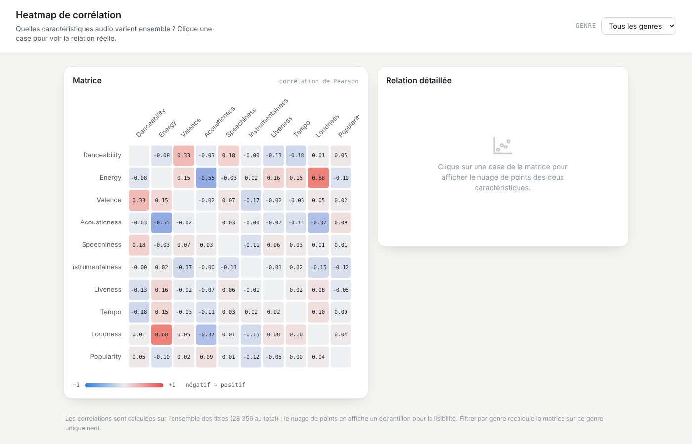
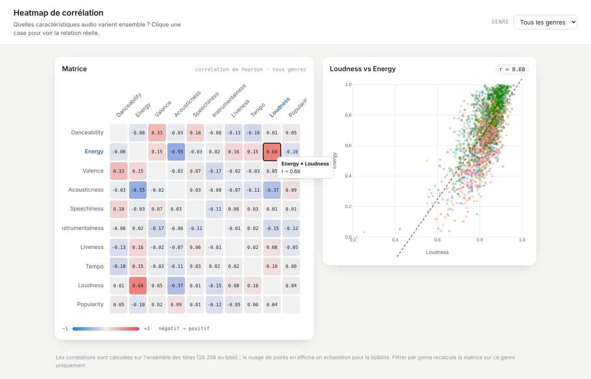
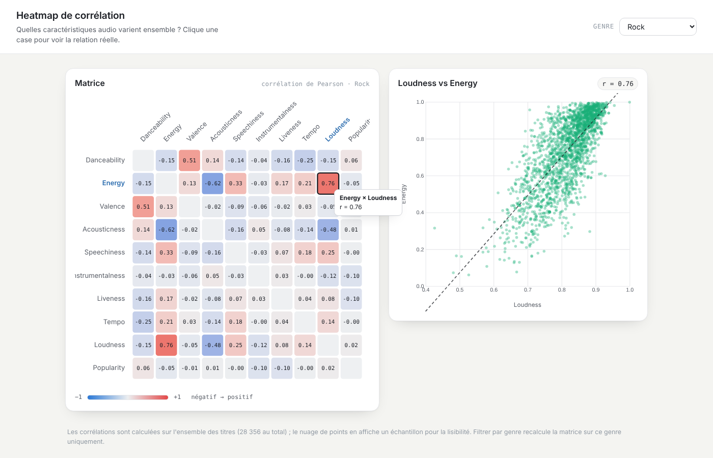

# Heatmap de corrélation : quelles caractéristiques vont ensemble ?

[← Sommaire](../../README.md)

**Auteure : Maud Marconcini**

Fichiers : [`heatmap.html`](../../heatmap.html) · [`js/heatmap/heatmap.js`](../../js/heatmap/heatmap.js)
Données : [`data/derived/correlation.json`](../../data/derived/correlation.json) (D4, matrice « tous genres ») et [`data/derived/tracks_features.csv`](../../data/derived/tracks_features.csv) (D1, pour le recalcul par genre et le nuage de points)

## 1. Question et données représentées

La vue répond à une question **analytique** : **quelles caractéristiques audio varient ensemble ?** Autrement dit, quelle est la *structure interne* du son dans le catalogue — quelles variables se ressemblent, s'opposent, ou sont indépendantes.

La donnée affichée n'est pas le catalogue lui-même mais une **matrice de corrélation** calculée dessus. Pour chaque paire parmi **10 variables** — 9 caractéristiques audio (danceability, energy, valence, acousticness, speechiness, instrumentalness, liveness, tempo, loudness) + la **popularité** — on calcule le coefficient de corrélation de **Pearson**, un nombre entre −1 et +1 :

- **+1** : les deux variables augmentent toujours ensemble ;
- **0** : aucune relation linéaire ;
- **−1** : quand l'une monte, l'autre descend.

C'est donc une **variable calculée** (au sens du cours : elle n'est pas stockée, elle se dérive), obtenue à partir des **28 356 titres**. On passe ici de la donnée brute (les features de chaque titre) à une **information de second niveau** : la relation entre ces features.

La matrice « tous genres » est pré-calculée dans le pipeline (D4). Le recalcul par genre, lui, lit les features normalisées (D1). Les deux sont parfaitement cohérents car **le coefficient de Pearson est invariant à toute transformation linéaire** : qu'on travaille sur `tempo` en BPM ou sur `tempo` normalisé entre 0 et 1, le coefficient est identique (Pearson divise déjà par l'écart-type).

## 2. Pourquoi une heatmap (et pas autre chose)

Le choix découle de la **structure de la donnée** : une **matrice carrée** de valeurs. La heatmap est la technique faite pour ça. Mais le point important est de comprendre ses **avantages par rapport aux alternatives** :

| Technique envisageable | Pourquoi écartée |
|---|---|
| **Tableau de chiffres** | On a 45 coefficients : on les lit un par un, sans voir d'un coup les plus forts. La couleur fait ressortir l'essentiel instantanément (pré-attentif). |
| **Un nuage de points** | Ne montre qu'**une seule paire** à la fois. Pour comparer les relations entre elles, il en faudrait 45 côte à côte. |
| **Matrice de nuages (SPLOM)** | Montre bien toutes les paires, mais chaque nuage devient minuscule et illisible dès qu'il y a 10 variables. |
| **Graphe de corrélations** | Un réseau où les arêtes sont les corrélations : joli, mais on perd la lecture systématique « telle variable × telle variable ». |

**L'avantage décisif de la heatmap** : elle montre les **45 paires en même temps, à la même taille**, dans une grille où l'on retrouve n'importe quelle paire par sa ligne et sa colonne. On compare les forces d'un simple coup d'œil.

**Son inconvénient** — et c'est ce qui justifie le reste de la vue : un coefficient **résume** une relation en un seul chiffre, et un chiffre peut **tromper** sur la forme réelle. C'est pour **combler cette faiblesse** qu'un clic ouvre le **nuage de points** : on retrouve alors les titres réels derrière le chiffre. La heatmap répond à la tâche « vue d'ensemble des relations », le nuage à la tâche « vérifier une relation précise » — deux techniques complémentaires, exactement l'esprit du projet.

**Mapping (variables visuelles).** La **position** (ligne × colonne) désigne la paire ; la **couleur** encode le signe et la force de la relation ; le **texte** dans la case donne la valeur exacte. Ni la taille ni la forme ne sont utilisées : la lecture tient en deux canaux, volontairement.

La vue suit le **mantra de Shneiderman** : *vue d'ensemble (la matrice) → filtre (par genre) → détails à la demande (le nuage au clic)* — les **deux niveaux de lecture** exigés par le projet.

## 3. Utilisateurs et tâches

Deux profils utilisent cette vue, pour la même tâche de fond (**Correlate**) mais avec des buts différents :

- **Journaliste / créateur de contenu** — *Correlate pour raconter* : trouver une relation parlante à illustrer (« plus un titre est fort, plus il est énergique »).
- **Analyste label / A&R** — *Correlate pour décider* : repérer les caractéristiques **liées ou redondantes** (deux variables qui disent presque la même chose → on peut n'en garder qu'une), et voir si ces relations **changent selon le genre**.

| Tâche (cours) | Comment la vue la supporte |
|---|---|
| **Vue d'ensemble** | Les 45 paires dans une seule grille, valeur écrite dans chaque case |
| **Correlate** | Couleur divergente : case la plus saturée = relation la plus forte (signe par la teinte) |
| **Compare** | Filtre par genre qui recalcule la matrice → on compare les relations d'un genre à l'autre |
| **Find relationships / redondance** | Lecture directe des paires fortes (ex. energy ↔ loudness) = features redondantes |
| **Details-on-demand** | Infobulle sur une case, nuage de points de la paire au clic |
| **Find anomalies** | Points éloignés de la droite de tendance dans le nuage, nom du titre au survol |

## 4. Mode d'emploi

### 4.1 Lire la matrice (le niveau « vue d'ensemble »)

Chaque case donne la corrélation entre la variable de sa **ligne** et celle de sa **colonne**. Le survol met en avant les deux noms de variables et affiche la valeur. La **diagonale** (une variable avec elle-même, toujours égale à 1) est grisée : elle ne porte aucune information. La matrice est **symétrique** — corr(A, B) = corr(B, A) — et on l'affiche **entière** (et non une seule moitié) pour pouvoir lire une **ligne ou une colonne** complète d'un trait, sans la reconstituer mentalement : par exemple, parcourir toute la ligne « Popularity » pour voir d'un coup à quoi la popularité est liée.

### 4.2 Voir la relation réelle (le niveau « détail »)

Un clic sur une case affiche à droite le **nuage de points** des deux variables, avec une **droite de tendance** en pointillés, et les points **colorés par genre**. Pour rester lisible, le nuage montre un **échantillon** d'au plus 2 500 titres, ce qui est indiqué en bas de la page ; le **coefficient, lui, reste calculé sur tous les titres**. La droite de tendance est ajustée sur l'échantillon affiché.

Pourquoi ce détail est essentiel : un même coefficient peut cacher des formes très différentes — c'est le **quartet d'Anscombe** du cours — et surtout, une **corrélation n'est pas une causalité**. La vue sert à *repérer* un lien et à en *vérifier la forme*, pas à conclure une cause.

*Scénario (journaliste) :* « Les morceaux plus forts sont-ils plus énergiques ? » La case la plus rouge est **energy × loudness (r = 0,68)**. Le nuage confirme une relation nette et régulière : un sujet d'article solide. La relation la plus négative est **energy × acousticness (r = −0,55)** : les titres acoustiques sont plus calmes.

*Scénario (analyste label) :* « Peut-on prédire la popularité à partir du profil audio ? » Toute la ligne **« Popularity » est presque grise** : aucune corrélation ne dépasse **0,13** en valeur absolue (la plus forte est instrumentalness, −0,124). Conclusion exploitable et contre-intuitive : dans ce dataset, **la popularité d'un titre ne s'explique pas par ses caractéristiques audio** — inutile de miser sur une « recette sonore » pour viser le succès.

### 4.3 Filtrer par genre

Choisir un genre **recalcule entièrement la matrice** sur les seuls titres de ce genre, et le nuage de points suit.

*Scénario (analyste label) :* « Les relations sont-elles les mêmes dans tous les genres ? » **Non** : energy × loudness monte à **0,76 dans le rock** (contre 0,68 tous genres), et danceability × valence passe de **0,33 (tous genres)** à **0,51 dans le rock**, contre **0,25 seulement dans le rap**. Message : **une corrélation globale n'est pas forcément vraie dans chaque genre** — d'où l'intérêt de pouvoir filtrer.

Ce filtre par genre est le **filtre commun du projet** : posé ici, il reste actif quand on passe aux autres vues (et inversement). C'est la brique « un seul système » côté heatmap.

## 5. Choix de conception

- **Échelle divergente** (bleu négatif → gris zéro → rouge positif), parce que la donnée a un **zéro naturel** et **deux sens opposés** : une échelle séquentielle serait trompeuse ici.
- **Interpolation Lab** (perceptuelle) de cette échelle, pour que les corrélations **moyennes** restent distinguables ; une interpolation RGB les rendrait toutes grisâtres et « plates », surtout en sombre.
- **Valeur écrite dans chaque case**, avec une **couleur de texte calculée** selon la clarté du fond (contraste suffisant) : l'information n'est **jamais portée uniquement par la couleur** — lisible aussi pour un daltonien.
- **Diagonale neutralisée** et **matrice entière** : deux décisions de lisibilité expliquées en 4.1.
- **Couleurs adaptées au thème** : la vue relit ses variables CSS et **se redessine** quand on bascule clair/sombre (via l'observation de `data-theme`), pour rester cohérente avec le tableau de bord.
- **Honnêteté** : une note en bas de page indique que le nuage est un **échantillon** et que le coefficient est calculé sur l'ensemble des titres — on ne laisse pas croire à une précision ou une exhaustivité qui n'existent pas.

## 6. Fonctions principales

Le fichier [`js/heatmap/heatmap.js`](../../js/heatmap/heatmap.js) suit la chaîne *charger → dessiner → réagir* :

| Fonction | Entrée | Sortie / rôle |
|---|---|---|
| `pearson(xs, ys)` | Deux listes de valeurs | Coefficient de corrélation de Pearson |
| `computeMatrix(rows)` | Titres (d'un genre) de D1 | Matrice 10 × 10 arrondie au millième (recalcul par genre) |
| `colorScale()` | Les variables CSS du thème | Échelle divergente en interpolation Lab |
| `renderMatrix(matrix)` | Une matrice | Grille de cases colorées, libellés, infobulle, clic |
| `showScatter(i, j)` | Indices d'une paire | Nuage de points échantillonné + droite de régression + badge `r` |
| `buildGenreFilter()` | Genres du projet, filtre commun | Menu déroulant synchronisé avec les autres vues |

Au chargement, `Promise.all` récupère `correlation.json` (la matrice « tous genres ») **et** `tracks_features.csv` (pour le nuage et les recalculs), puis dessine la matrice ; le reste est piloté par les interactions (survol, clic, filtre, changement de thème).

## 7. Limites et pistes

- La corrélation de Pearson ne mesure que les relations **linéaires** : une relation en U (forte mais non monotone) apparaîtrait proche de 0. Le **nuage de points** permet justement de le vérifier paire par paire — c'est le garde-fou.
- L'échantillon du nuage est pris à **intervalles réguliers** dans le fichier ; un **tirage aléatoire stratifié par genre** serait plus représentatif.
- Les cases ne sont pas encore **navigables au clavier** : une amélioration d'accessibilité à prévoir (la valeur écrite et le contraste couvrent déjà une partie du besoin).
- **Piste d'extension** : réordonner lignes et colonnes pour **regrouper les variables corrélées** (comme un *TableLens* / clustering), afin de faire apparaître des blocs de features liées plutôt qu'un ordre fixe.
