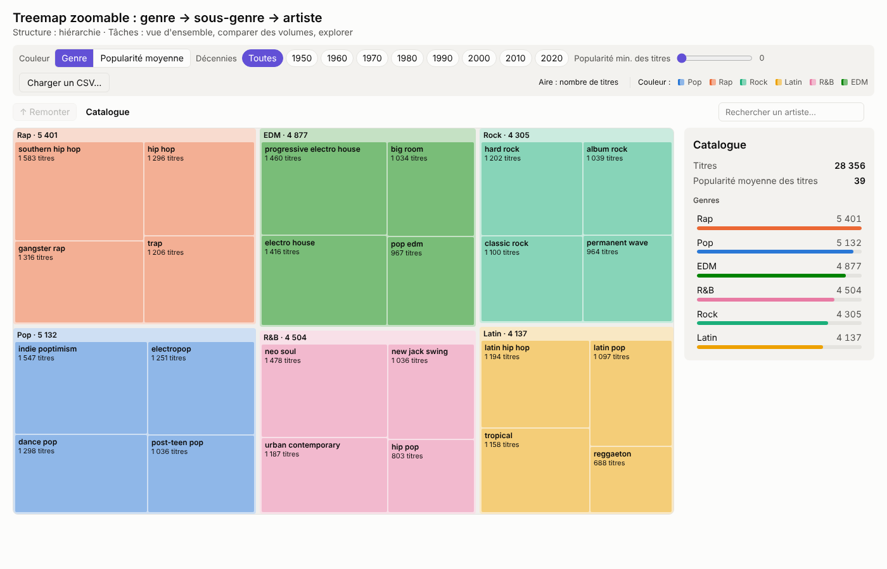
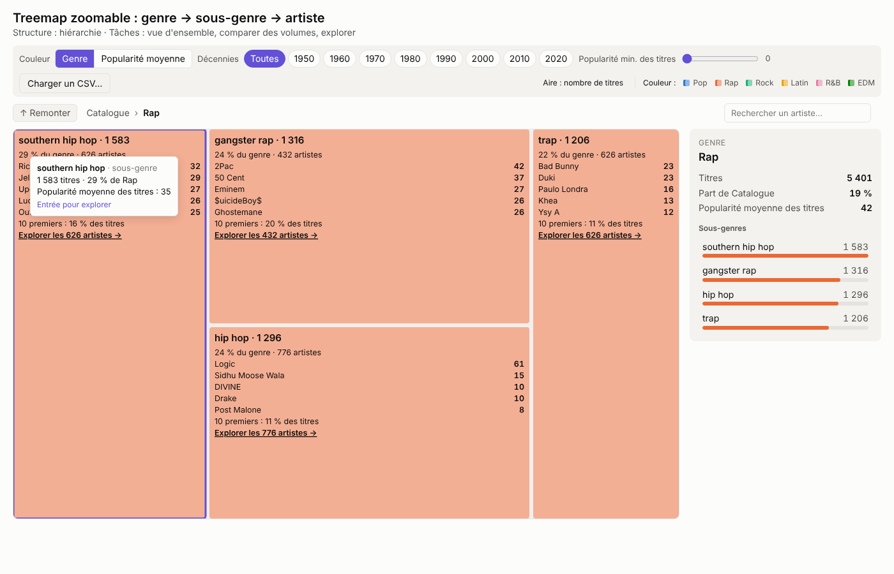
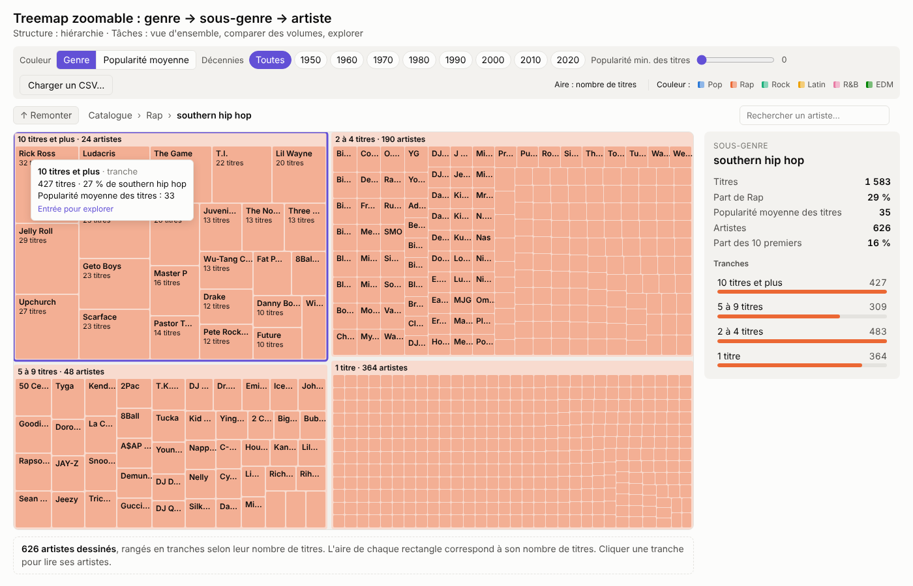
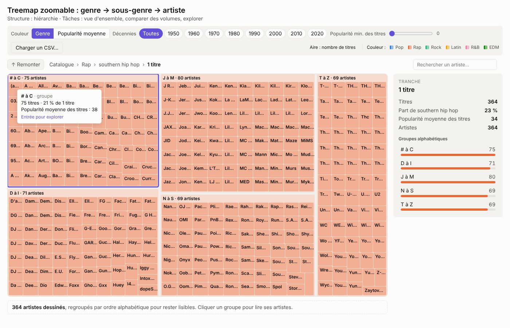
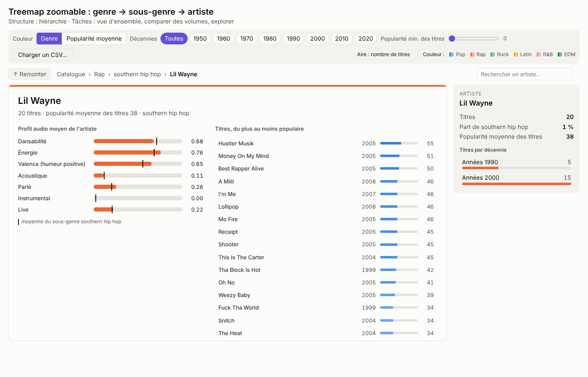
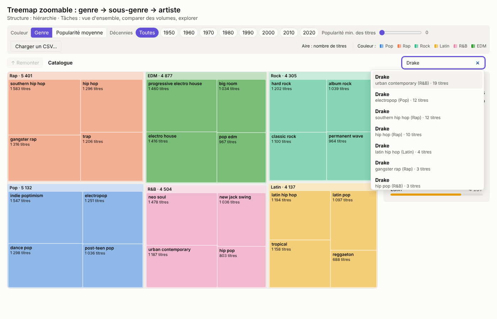
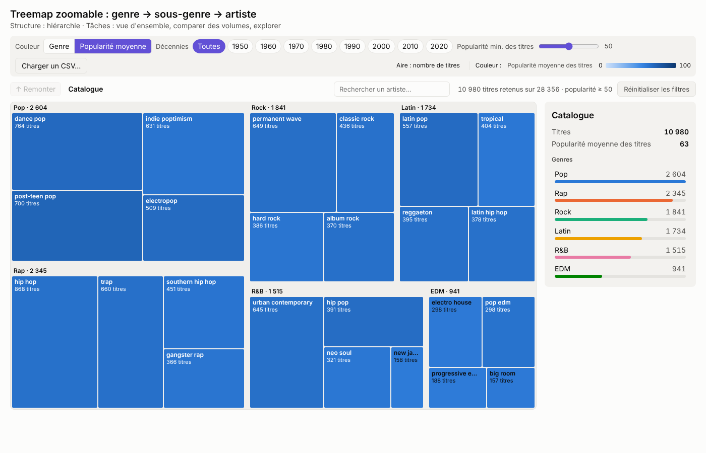

# Treemap zoomable : genre → sous-genre → artiste

[← Sommaire](../../README.md)

**Auteure : Arij Lemjid**

Fichiers : [`treemap.html`](../../treemap.html) · [`js/views/treemap.js`](../../js/views/treemap.js) · [`css/treemap.css`](../../css/treemap.css)
Données : [`data/derived/hierarchy.json`](../../data/derived/hierarchy.json) (D2) et [`data/derived/tracks_clean.csv`](../../data/derived/tracks_clean.csv) (D0)

## 1. Question et données représentées

La vue répond à la question : **comment le catalogue se répartit-il entre genres, sous-genres et artistes ?**

Le dataset a une structure hiérarchique naturelle sur trois niveaux :

| Niveau | Nombre | Exemple |
|---|---|---|
| Genre | 6 | rap |
| Sous-genre | 24 (4 par genre) | southern hip hop |
| Artiste | 10 692 artistes, soit 14 700 couples artiste / sous-genre | Rick Ross |

Un même artiste peut apparaître dans plusieurs sous-genres (Drake est présent dans 11 sous-genres), c'est pour ça qu'on compte 14 700 feuilles pour 10 692 artistes.

La grandeur représentée est le **nombre de titres** : c'est une quantité additive (les titres d'un genre sont la somme des titres de ses sous-genres), ce qui est la condition pour qu'une treemap soit juste.

## 2. Pourquoi une treemap zoomable

J'ai hésité entre une treemap et un sunburst, qui représentent tous les deux une hiérarchie avec des parties d'un tout.

- **Comparer des volumes** : dans une treemap, la quantité est codée par une **aire rectangulaire**. Dans un sunburst, elle est codée par un **angle** sur des anneaux de rayons différents, donc une même part n'a pas la même surface selon l'anneau. D'après le classement des canaux de Munzner, l'aire alignée est plus facile à comparer qu'un angle, et le sunburst déforme les niveaux extérieurs.
- **Place à l'écran** : la treemap utilise tout le rectangle disponible, sans centre vide. Avec 14 700 feuilles, chaque pixel compte.
- **Lisibilité des noms** : les rectangles laissent la place d'écrire le nom et le nombre de titres à l'horizontale, ce qui est difficile sur des secteurs courbes.

Le zoom est nécessaire parce que 14 700 feuilles ne peuvent pas être lisibles en même temps. J'ai suivi le mantra de Shneiderman : **vue d'ensemble d'abord, zoom et filtres, puis détails à la demande**.

## 3. Utilisateurs et tâches

La vue sert surtout deux profils du projet :

- **Mélomane** : explorer le catalogue par plaisir, retrouver un artiste, découvrir des sous-genres.
- **Analyste label (A&R)** : repérer où se concentre la production, quels sous-genres sont dominés par quelques artistes, quels genres restent populaires.

| Tâche (vocabulaire du cours) | Comment la vue la supporte |
|---|---|
| Vue d'ensemble | Les 6 genres et leurs 24 sous-genres sont visibles dès l'ouverture |
| Comparer des parties d'un tout | Aire proportionnelle au nombre de titres, parts en % dans le panneau |
| Explorer / naviguer | Zoom par clic sur trois niveaux, fil d'Ariane, bouton « Remonter », Échap |
| Localiser | Recherche d'un artiste, qui liste tous les sous-genres où il apparaît |
| Filtrer | Décennies, popularité minimale des titres, genre commun à toutes les vues |
| Détails à la demande | Infobulle au survol, panneau latéral, fiche artiste avec profil audio et titres |

## 4. Mode d'emploi

### 4.1 Vue d'ensemble

À l'ouverture, la treemap montre le catalogue entier (image ci-dessus) : un bloc par genre, découpé en sous-genres. Le panneau de droite donne le total de titres, la popularité moyenne et un classement des genres.

On voit tout de suite que les genres sont **équilibrés** (de 4 137 titres pour le latin à 5 401 pour le rap). C'est une information en soi : le dataset a été constitué à partir de playlists, il ne représente pas la part réelle de chaque genre sur Spotify.

### 4.2 Zoom sur un genre

Un clic (ou Entrée) sur l'en-tête d'un genre zoome dessus avec une transition animée. Le zoom est **sémantique** : chaque sous-genre n'est plus seulement un rectangle, il affiche un résumé (part du genre, nombre d'artistes, 5 artistes principaux, part des 10 premiers artistes).

*Scénario (analyste A&R) :* « Quel sous-genre du rap est le plus concentré ? » Dans le rap, les 10 premiers artistes font 20 % des titres en gangster rap, contre 16 % en southern hip hop et 11 % en trap. Le gangster rap est donc plus dominé par quelques noms (2Pac, 50 Cent, Eminem), le trap est plus éclaté.

### 4.3 Zoom sur un sous-genre : tous les artistes, rangés en tranches

Un sous-genre contient souvent plus de 600 artistes, et beaucoup n'ont qu'un ou deux titres (61 % des artistes du dataset n'ont qu'un titre). Dessiner les 600 rectangles au même niveau les rendrait illisibles, mais n'en montrer qu'une partie donnerait une **fausse répartition** : quelques artistes occuperaient toute la surface alors qu'ils ne représentent qu'une partie des titres.

J'ai donc ajouté un niveau dans la hiérarchie : à l'intérieur d'un sous-genre, les artistes sont rangés en **tranches selon leur nombre de titres** (10 titres et plus, 5 à 9, 2 à 4, 1 titre). Chaque tranche a sa vraie aire, et **tous les artistes sont dessinés** dedans, même tout petits. Le nom n'apparaît que là où il y a la place.

Ces tranches ne sont pas qu'une astuce d'affichage : elles montrent directement **comment la production d'un sous-genre est répartie**. En southern hip hop, 24 artistes à 10 titres et plus font 27 % des titres, alors que 364 artistes à un seul titre en font 23 %.

Un clic sur une tranche zoome dessus. Quand une tranche contient plus de 80 artistes, elle est redécoupée **par ordre alphabétique** (« # à C », « D à I »… ; « # » regroupe les noms qui commencent par un chiffre ou un symbole). Ce dernier découpage n'a pas de sens musical : il sert seulement à ce que les noms restent lisibles. Un sous-genre de 40 artistes ou moins n'a pas besoin de tranches : ses artistes sont affichés directement.

C'est le principe des poupées russes : on va des blocs les plus gros aux plus petits, sans jamais retirer de données, et l'aire reste juste à chaque niveau. J'avais d'abord affiché les 30 artistes principaux avec un bouton « Afficher 30 de plus », mais cette solution faussait la répartition.

### 4.4 Fiche artiste (détails à la demande)

Un clic sur un artiste ouvre sa fiche dans la zone de la treemap :

- **Profil audio moyen** de l'artiste (dansabilité, énergie, valence…) avec un **repère noir** pour la moyenne du sous-genre. On voit tout de suite si l'artiste est plus ou moins dansant ou énergique que son sous-genre.
- **Liste de ses titres**, du plus au moins populaire, avec l'année et la popularité. Survoler un titre affiche son propre profil audio à la place de la moyenne.

*Scénario (mélomane) :* « Lil Wayne est-il plus dansant que la moyenne du southern hip hop ? » Sa dansabilité (0,68) est un peu en dessous du repère du sous-genre, sa valence est au-dessus : sa musique est plutôt plus « positive » que la moyenne. Son instrumental à 0,00 est une vraie valeur du dataset (titres entièrement chantés ou rappés), pas une donnée manquante : les valeurs manquantes sont affichées « n/d ».

### 4.5 Localiser un artiste

La barre de recherche (rôle ARIA *combobox*, utilisable au clavier) liste **toutes les apparitions** d'un artiste, avec le sous-genre, le genre et le nombre de titres. Choisir un résultat ouvre directement la fiche de l'artiste, dans sa tranche.

*Scénario (mélomane) :* « Dans quel style classer Drake ? » Il apparaît dans 11 sous-genres de 5 genres différents. La recherche liste ses 8 apparitions principales, triées par nombre de titres : urban contemporary (R&B) arrive en tête, devant electropop (pop) et southern hip hop (rap). La vue montre que le classement par genre est une simplification.

### 4.6 Filtres et couleur

- **Décennies** : des puces 1950 à 2020, combinables. Leur nombre de titres suit le filtre de popularité.
- **Popularité minimale des titres** : un curseur de 0 à 100. La hiérarchie est alors recalculée à partir de `tracks_clean.csv`, titre par titre, pour que le filtre porte bien sur les titres et pas sur des moyennes.
- **Couleur** : par genre (teintes claires pour que le texte reste lisible) ou par popularité moyenne (dégradé d'un seul bleu, échelle fixe de 0 à 100 pour que la même couleur veuille toujours dire la même valeur, quel que soit le filtre).
- Un résumé indique toujours les filtres actifs (« 10 980 titres retenus sur 28 356 · popularité ≥ 50 ») avec un bouton « Réinitialiser les filtres ».

*Scénario (analyste A&R) :* « Quels genres restent présents si on ne garde que les titres populaires ? » Avec une popularité minimale de 50, l'EDM passe de 4 877 à 941 titres et devient le plus petit genre, alors que la pop reste en tête. Le catalogue EDM contient beaucoup de titres peu écoutés.

### 4.7 Charger un autre jeu de données

Le bouton « Charger un CSV… » permet d'explorer un autre fichier avec la même vue. Il accepte le format nettoyé du projet comme le format brut de Kaggle (les noms de colonnes sont reconnus automatiquement), supprime les doublons, et attribue une couleur aux genres inconnus. Trois fichiers de démonstration sont fournis dans [`data/samples/`](../../data/samples/README.md). « Revenir au dataset d'origine » recharge le catalogue complet.

### 4.8 Coordination avec les autres vues

La treemap utilise le filtre de genre commun du projet ([`js/filters.js`](../../js/filters.js)) : choisir un genre dans l'index ou une autre vue zoome la treemap sur ce genre, et zoomer sur un genre dans la treemap le transmet aux autres vues.

## 5. Choix de conception

- **Couleur** : les genres gardent les couleurs communes à tout le projet (`DataLoader.GENRE_COLORS`), éclaircies pour les grands rectangles afin que le texte noir reste lisible. La couleur du texte (noir ou blanc) est choisie en calculant le contraste WCAG avec le fond.
- **Le visible et le caché** : le fil d'Ariane, le résumé des filtres et la ligne qui explique le rangement en tranches suivent le principe de Nielsen de visibilité de l'état du système : l'utilisateur sait toujours où il est et ce qu'il regarde.
- **Accessibilité** : tout est utilisable au clavier (Tab, Entrée, Espace, Échap pour remonter), le focus revient sur l'élément d'origine après un zoom, chaque rectangle a un libellé ARIA (« Rap, genre, 5 401 titres. Entrée pour explorer. »), et les animations sont coupées si le système demande moins de mouvement (`prefers-reduced-motion`).
- **Thème** : clair ou sombre, avec les mêmes couleurs de données dans les deux.

## 6. Fonctions principales

La vue réalise la dernière transformation du pipeline : elle passe des données dérivées aux rectangles.

| Fonction (`js/views/treemap.js`) | Entrée | Sortie |
|---|---|---|
| `prepare(raw, { decades })` | `hierarchy.json` (genre → sous-genre → artiste, titres et somme des popularités par décennie) | Arbre filtré par décennies, avec `count` et `popSum` à chaque nœud |
| `parseTrack(row)` | Une ligne de `tracks_clean.csv` | Un titre validé (popularité entre 0 et 100, genre, décennie), ou `null` |
| `prepareFromTracks(tracks, { decades, minPopularity })` | Liste de titres | Le même arbre, recalculé titre par titre (filtre de popularité, CSV importé) |
| `normalizeRows(rows)` | Lignes d'un CSV importé | Lignes au format du projet, ou la liste des colonnes manquantes |
| `subgenreNode(name, genre, artists)` | Artistes d'un sous-genre | Nœud du sous-genre, avec ses artistes rangés en tranches |
| `nestArtists(artists, genre)` | Artistes triés par nombre de titres | Tranches (10 et plus, 5 à 9, 2 à 4, 1), ou les artistes directement s'il y en a 40 ou moins |
| `byLetters(artists, genre)` | Artistes d'une tranche de plus de 80 | Groupes alphabétiques d'environ 80 artistes au plus |
| `layout(root, w, h)` | Arbre préparé et taille de la zone | Rectangles calculés par `d3.treemap` (algorithme *squarify*) |
| `popMean(node)` | Un nœud | Popularité moyenne de ses titres (`popSum / count`) |

## 7. Limites et pistes

- Retrouver un artiste précis n'est pas le point fort d'une treemap (ni d'un sunburst) : son rôle est de montrer la répartition. La recherche est un complément, et le profil audio d'un artiste se compare mieux avec les coordonnées parallèles.
- Les seuils des tranches (10, 5, 2, 1 titres) sont fixés et les mêmes pour tous les sous-genres. Un découpage par quartiles s'adapterait à chaque sous-genre, mais serait moins facile à lire.
- Le découpage alphabétique sert à la lisibilité, il n'apporte pas d'information.
- Quand on zoome, le reste du catalogue n'est plus visible (vue d'ensemble + détail plutôt que focus + contexte). Une mini-carte du catalogue dans un coin garderait le contexte.
- En couleur par popularité, les moyennes des sous-genres restent entre 24 et 55 : sur une échelle de 0 à 100, les différences sont faibles. Une échelle fixe plus resserrée les rendrait plus visibles.
- La recherche affiche au plus 8 résultats sans indiquer qu'il y en a d'autres (Drake en a 11). Il faudrait ajouter « + 3 autres ».
- Le rock et l'EDM ont deux verts proches dans la palette commune, difficiles à distinguer pour une personne daltonienne.
